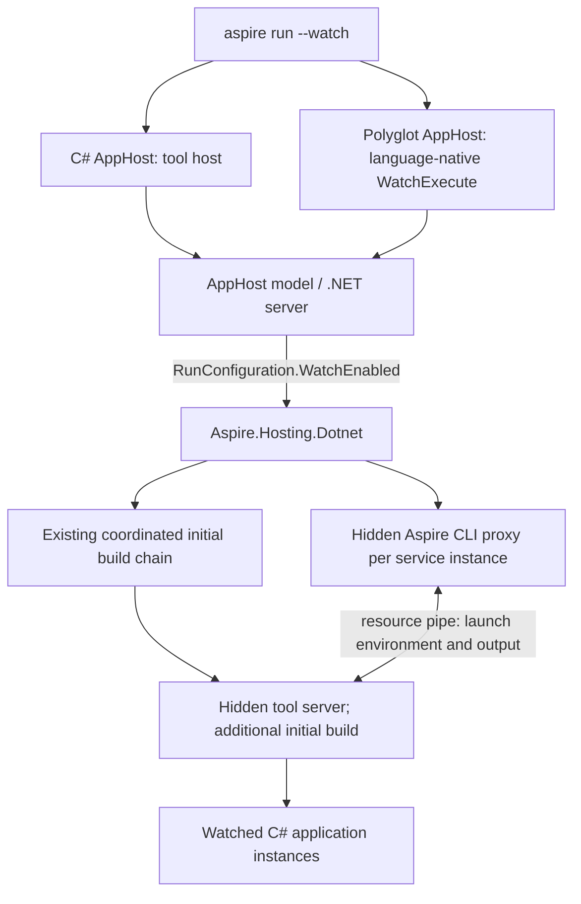

# Project v2 — C# projects and `aspire run --watch`

Reviewed against repository commit `a7ea8cd890` and the published watch package on **2026-10-26**.
“Implemented” below describes source and checked-in coverage, not a fresh execution of every scenario.
The Project v2 foundation is implemented and used by new C# templates; the watch integration remains future work.

## 1. Scope and agreed boundaries

Complete CLI watching on top of the existing `Aspire.Hosting.Dotnet` language integration, without
regressing normal run, publishing, or IDE behavior.

| Concern | Agreed direction |
|---|---|
| Resource model | `DotnetProjectResource : ExecutableResource`, added by path through `AddDotnetProject` / polyglot `addDotnetProject`. Retain legacy project APIs for compatibility. |
| Activation | **`aspire run --watch`**, a local-run sub-mode, not a standalone command. The explicit option takes precedence; the existing `defaultWatchEnabled` feature flag supplies the default. |
| Ownership | Core supplies general run state and shared project capabilities; the language package owns service-watch orchestration. CLI owns AppHost launching and the infrastructure proxy described in §4. |
| CLI versus IDE | The new package integration is **CLI-only**. Real IDE runs use their own watching/restart functionality and IDE session notifications, not these watch-package commands. Non-watch F5 parity remains required. |
| AppHost watching | Use the tool's `host` command for C# CLI AppHosts. Retain guest runtimes' language-native `WatchExecute`, when available, for polyglot AppHost code; separately watch their C# services. |
| Initial builds | Retain Aspire's coordinated initial build in watch and non-watch process runs. Accept the tool's additional initial restore/build; avoiding it is an open implementation issue and potential performance improvement, not a rollout prerequisite. IDE build ownership remains capability-dependent (§2.2). |
| Tool acquisition | Resolve the NuGet tool through the AppHost's integration/package graph, not by bundling it into the CLI. Keep non-watch runs independent of watch-specific runtime requirements. |
| Compatibility | Begin with verified-compatible build/launch contexts. Support broad resource shapes with **targeted rejections**, not a blanket single-instance restriction (§5). |
| Environment transport | Use an **Aspire-owned, hidden infrastructure CLI proxy**, one per resource instance, instead of passing service environment values through the package's `resource -e` command. Explicitly own and version-test the pipe contract; do not reference internal package types. |

These boundaries supersede the prototype's incremental-build-only assumption and direct `resource -e`
launch proposal. They do not authorize a redesign of IDE execution or a migration of every specialized
legacy resource to Project v2.

## 2. Implemented foundation

### 2.1 Resource surface and default adoption

`Aspire.Hosting.Dotnet` now supplies the non-experimental `DotnetProjectResource`, `AddDotnetProject`,
and `WithBuildEnvironment` surface. A resource accepts a `.csproj`, a directory containing one
`.csproj`, or a file-based `.cs` app. Relative paths resolve against the AppHost directory.
The polyglot `addDotnetProject` dispatcher uses a dedicated options DTO for launch-profile/Kestrel
settings while preserving the legacy `ProjectResourceOptions` contract.

New C# templates use plain `Microsoft.NET.Sdk`, explicit `Aspire.Hosting.AppHost` and
`Aspire.Hosting.Dotnet` references, and path-based resources rather than service `ProjectReference`s.
`Aspire.AppHost.Sdk` is deprecated with suppressible `ASPIRE012` migration guidance, not removed.
`Aspire.Hosting.AppHost` does **not** implicitly reference `Aspire.Hosting.Dotnet`.
Building a package-only AppHost alone no longer builds its services; their run-time coordinated build
is a separate operation. See [SDK migration guidance](../migrate-from-apphost-sdk.md).

Core `AddProject<T>` / `AddProject` still create `ProjectResource`; they have not been redirected to V2.
`AddCSharpApp` / `addCSharpApp` are obsolete in favor of the Dotnet integration, but retain their
legacy implementation. Polyglot V2 capabilities are available through that integration; this does not
mean every polyglot starter includes C# services or has been migrated.

### 2.2 Launch, shared defaults, and IDE execution

`WithProjectDefaults` and `ProjectLaunchDefaultsAnnotation` share launch-profile materialization,
OpenTelemetry settings, service-discovery environment, launchSettings/Kestrel endpoints, certificate
defaults, and the Rebuild command between legacy and V2 resources. Integration-authoring seams remain
experimental where annotated (`ASPIREPROJECTS001` / `ASPIREEXTENSION001`); the package's graduation
did not graduate all core helper APIs. The package source-links low-level helpers and consumes public
core APIs, without production `InternalsVisibleTo`.

The normal coordinated `.csproj` process path queries MSBuild `ComputeRunArguments` **after successful
build completion**, then launches its `RunCommand` / `RunArguments` and applicable `RunWorkingDirectory`
directly. It is not simply `dotnet run --project` in every case. File-based apps use
`dotnet run --file <path> --no-build` after their direct build; uncoordinated paths retain SDK-run
behavior. File-based apps require .NET SDK 10 or later.

`WithLaunchToolArgs` separates the replaceable invocation prefix from application arguments supplied
by `WithArgs`. The latest prefix wins; IDE ownership can omit it without leaking tool switches into
the program. Selected launch-profile arguments remain application arguments; process launches suppress
SDK profile handling because Aspire materializes the profile environment itself.

DCP now selects a launch policy and renders a complete launch recipe rather than relying on the old
project-only special case. V2's project metadata/debug annotation is recognized; failed IDE launch
configuration production does not silently retry as a process. Persistent resources and unsupported
debug capabilities use the normal process path.

Coordinated IDE execution uses **`project-with-external-build.v1`**, carrying build configuration,
build environment, build working directory, and build suppression. If an active IDE does not advertise
that capability, the coordinator stands aside and ordinary `"project"` launch leaves builds to the IDE.
Capability-less legacy sessions do not implicitly support bare `.cs` resources.

The VS Code extension advertises the versioned capability and honors these values. Its file-app path
uses SDK run-property / `dotnet run-api` resolution, preserves required `DOTNET_ROOT*` host settings,
and keeps selected/disabled profiles authoritative. Its IDE protocol already reports
`processRestarted` and `sessionTerminated`; those mechanisms are distinct from the watch pipes in §3.

### 2.3 Coordinated build contract

`DotnetProjectBuildCoordinator` owns the run-mode build plan and final successful-build barrier.
Important implemented details that watch integration must preserve:

- The plan is materialized in a **BeforeStart final action**, after build-affecting configuration is
  supplied. Removed/replaced resources are excluded. Materialization failures roll back and can be retried.
- Compatible `.csproj`s share a traversal by physical nearest-`global.json` identity and build
  configuration. Child MSBuild tasks build in parallel without introducing solution-specific properties.
  Symlink aliases are deduplicated. De-duplication within a group does not promise one build across
  incompatible contexts.
- `WithBuildEnvironment` causes a separate direct build; ordinary runtime environment, launch profiles,
  service references, and a custom runtime working directory do not split traversal groups. File apps
  also build directly. All groups/direct builds are serialized to avoid shared-output races, including
  file apps' `#:project` references.
- Every participating service/replica waits for the **whole chain** to succeed, including forced starts.
  Missing paths instead fail on their own ordinary launch path without poisoning valid siblings.
- Traversals use aggregate NuGet restore by default. `Aspire:Dotnet:RestoreProjectsIndividually` opts
  out; static-graph restore or unavailable selected NuGet targets use the logged per-project fallback.
  Context-specific and file-app builds remain direct builds.
- Generated content-addressed projects live under
  `<Aspire:Store:Path>/.aspire/build` in the AppHost's resolved intermediate output, with atomic
  publication, cross-process leases, and a 24-hour inactive retention period.
- Build-only callbacks are evaluated once per attempt and shared by build, rebuilder, run-property
  query, and IDE metadata. They are refreshed on subsequent attempts, not copied into runtime
  environment. Late callback-set mutations and unsupported value types fail explicitly.
  `WithBuildEnvironment` is `.csproj`-only and is **not a secret transport**; protected response files
  preserve MSBuild global-property semantics without putting values in process arguments.
- `DotnetProgramBuildCompletionAnnotation` lets consumers wait for output without waiting for runtime
  readiness. It observes current attempts/rebuild failures; consumer cancellation does not cancel
  other consumers. Shared core SDK probing adds `-mt` to Aspire-managed builds only when supported,
  with separate compatibility boundaries for project and file-app builds.

Publish mode does not create these run-mode build resources. Merely setting `WatchEnabled` currently
does not change the coordinated build or turn on service watching.

### 2.4 Publishing and consumer parity

The former publishing work item (Session 5b) is **implemented**, not outstanding scaffolding.
`IDotnetProgramResource` supplies shared identity; a separate publishing capability supplies behavior.
`AddDotnetProject` calls `WithDotnetProgramPublishing` automatically. Direct construction/identity alone
does not configure publishing.

The shared pipeline produces project manifests, builds/pushes .NET SDK container images, and supports
container-file layering and archive output. Consumers have been generalized across Docker Compose,
Kubernetes, Azure Container Apps/App Service, Radius, Sandboxes, Foundry hosted agents, and Blazor.
Keep the distinction between snapshot/configuration coverage and actual deployed-runtime verification;
not every resource-kind/target combination has been freshly exercised by this review.

EF migration APIs accept shared .NET-program resources and use build-readiness support; file-based
apps are explicitly unsupported there. Prebuilt images plus `PublishWithContainerFiles` are rejected
with guidance. File-app cross-OS Native AOT failures receive actionable guidance, not an automatic AOT
configuration change. Container artifact identity/platform properties cannot be overridden through
`WithBuildEnvironment`.

Blazor retains `AddBlazorGateway` and adds `AddDotnetProjectBlazorGateway`, sharing helper logic.
Development uses the official gateway tool; publishing uses the packaged `Gateway.cs` companion.
Assets support C# MSBuild and direct polyglot package loading. The V2 client overload exports
`withDotnetProjectBlazorClientApp` while retaining `withBlazorClientApp` as its generated method name.
TypeScript/Go/Java/Python fixtures cover generated APIs, and a package-backed TypeScript E2E scenario
checks served client assets; that is not browser-execution or publishing evidence.

### 2.5 Watch state, CLI gap, and dogfood

Core's experimental (`ASPIREWATCH001`) `RunConfiguration` DTO exposes `bool WatchEnabled`.
`DistributedApplicationBuilder` reads **`AppHost:Run:WatchEnabled`** in run mode; absent/invalid values
and publish mode yield `false`. The execution context's configuration is read-only and never null.
Core contains no watch-package commands, tool resolution, or pipe protocol.

There is **no implemented `aspire run --watch` option or watch-package dependency/launch wiring** in
this checkout. The existing `defaultWatchEnabled` flag still selects whole-AppHost `dotnet watch`
for project-based C# AppHosts, or guest `WatchExecute` plus backchannel reconnection. These paths do
not yet activate the new service-watch signal. File-based C# AppHosts are excluded from that old
whole-AppHost watch path.

`playground/DotnetProject` provides C# and TypeScript AppHosts, two project services sharing a class
library, and a file-based service. Both AppHosts reference the API from the other services; they do
not currently add explicit `WaitFor` calls. Use this existing harness rather than creating another.

### 2.6 Implementation landmarks

| Milestone | Repository history |
|---|---|
| Resource/package foundation | [#18442](https://github.com/microsoft/aspire/pull/18442), API follow-up [#18981](https://github.com/microsoft/aspire/pull/18981) |
| Blazor development tool and polyglot exports | [#19432](https://github.com/microsoft/aspire/pull/19432), [#19026](https://github.com/microsoft/aspire/pull/19026) |
| Launch-argument separation, coordinated builds, unified restore | [#19552](https://github.com/microsoft/aspire/pull/19552), [#19678](https://github.com/microsoft/aspire/pull/19678), [#20294](https://github.com/microsoft/aspire/pull/20294) |
| Publishing and polyglot options | [#19997](https://github.com/microsoft/aspire/pull/19997), [#20157](https://github.com/microsoft/aspire/pull/20157) |
| File-app legacy-IDE handling and SDK-aware multithreaded builds | [#20243](https://github.com/microsoft/aspire/pull/20243), [#20337](https://github.com/microsoft/aspire/pull/20337) |
| Package graduation and obsolete predecessor | [#20490](https://github.com/microsoft/aspire/pull/20490), [#20582](https://github.com/microsoft/aspire/pull/20582), [#20825](https://github.com/microsoft/aspire/pull/20825) |
| Package-only templates and SDK deprecation | [#20867](https://github.com/microsoft/aspire/pull/20867) |

## 3. Published watch tool contract

### 3.1 Verified version, acquisition, and runtime

The latest stable **`Microsoft.DotNet.HotReload.Watch.Aspire` is `10.0.403`**, published
`2026-10-25T17:09:38.560Z`. The NuGet version index, catalog, actual package metadata, and PDB SourceLink
identify `dotnet/dotnet` commit **`5a2162bea6845eabc1fc721624a43568c65db3b1`**
(SDK source revision `d037e5f857b35e7260f575ae026ef30511776c0f`). The contract below is from that
revision, not the old `karolz-ms/aspire-watch` prototype or upstream `main`.

The approved **dotnet-public mirror already lists `10.0.403`** under the repository's existing source
mapping. Do not retain a speculative “mirror before starting” task or add nuget.org as a package source.
Recheck availability when changing the pin.

This is a `DotnetTool` package, not a library/client SDK. Its payload is under `tools/net10.0/any/`,
with entry point `Microsoft.DotNet.HotReload.Watch.Aspire.dll`, adjacent `.deps.json` /
`.runtimeconfig.json`, dependencies, and hot-reload agent assets. `dotnet exec <tool.dll>` needs
that payload intact. Its runtimeconfig requests **both `Microsoft.NETCore.App` and
`Microsoft.AspNetCore.App` `10.0.14`**, with no explicit major-version roll-forward policy.
An installed .NET 11 SDK alone does not establish that these runtime requirements are satisfied.

A bare library `PackageReference` to a tool package can fail `NU1212`. Acquisition-only references
must exclude compile/runtime assets (for example, `ExcludeAssets="all"`); `PrivateAssets="all"` alone
does not do that. `GeneratePathProperty` locates restored content but does not distribute it to consumers.
The planned package `.targets` must inject the resolved tool path as AppHost assembly metadata;
the runtime reader gives an explicit environment override precedence over that metadata.
Verify payload propagation for both MSBuild-backed and directly loaded polyglot integrations,
where package targets are not necessarily executed.

### 3.2 Commands and SDK context

The package provides the following commands; the **package** `resource` command is documented here
for comparison, not selected as Aspire's environment-carrying proxy (§4).

```text
server --sdk <sdkDirectory> --server <resourcePipe>
       [--resource <project-or-file> ...]
       [--status-pipe <pipe>] [--control-pipe <pipe>] [--verbose | --quiet]

resource --server <resourcePipe> --entrypoint <project-or-file>
         [-e|--environment KEY=VALUE ...]
         [--no-launch-profile | --launch-profile|-lp <name>] [--verbose | --quiet]
         [application arguments...]

host --sdk <sdkDirectory> --entrypoint <project-or-file>
     [--no-launch-profile | --launch-profile|-lp <name>] [--verbose | --quiet]
     [application arguments...]
```

`--sdk` is the concrete SDK/MSBuild directory passed to `MSBuildLocator.RegisterMSBuildPath`, not the
installation root or a version string. The muxer is derived from `<sdkDirectory>/../../dotnet[.exe]`.
Resolve it in the appropriate project/build environment; it does not independently override all
subsequent SDK selection. No tested SDK compatibility matrix is established by this source review.

These commands expose no configuration/TFM/RID/property-bag, arbitrary executable/working-directory,
or precomputed `RunCommand` / `RunArguments` override contract. The watcher reevaluates SDK run
properties via its own `dotnet run --no-build`; it does not adopt Aspire's resolved launch plan.

**`server` and `host` restore/build on their first watch iteration.** Neither exposes `--no-build` /
`--no-restore`. Shared-library hot reload is covered by package integration-test source; rude edits
can restart affected applications rather than always applying deltas in place.

### 3.3 Pipe roles, framing, and lifecycle

| Channel | Ownership and wire format |
|---|---|
| Resource launch/output | Watch server owns a bidirectional, asynchronous, current-user-only pipe; each proxy is a client. Client writes version byte `1`, then JSON as a UTF-8 string with a 7-bit-encoded byte-length prefix. Server ACK is byte `1` (`0` for an incompatible version). Output frames are stdout/stderr type byte `1`/`2` followed by a length-prefixed UTF-8 string. |
| Status | Integrator owns the pipe server; watcher connects as output client. Newline-delimited JSON carries `type`, `projects`, and optional `success`, `error`, `exitCode`. Types: `building`, `build_complete`, `hot_reload_applied`, `restarting`, `process_exited`, `process_started`. |
| Control | Integrator owns the pipe server; watcher connects as input client. The only command is newline-delimited `{"type":"rebuild","projects":["<full path>"]}`. It restarts matching running instances; it does **not** perform a build. No request ID/response acknowledgment exists. |

The resource JSON request contains `EntryPoint`, `ApplicationArguments`, `EnvironmentVariables`, and
`LaunchProfileName` (the package's `Optional<string?>` representation). It has no resource name,
instance ID, PID, build-context fields, stdin, or application-exit frame.

**One proxy connection is associated with one resource instance.** Closing it terminates that
connection's application, and the connection survives application restarts. Multiple instances of a
project are supported internally; only the separate status/control channels collapse identity to
project paths. A project-scoped control operation therefore selects all matching running instances.

ACK means **request accepted**, not application started/healthy. The package proxy's connection
timeout defaults to 30 seconds (`ASPIRE_WATCH_PIPE_CONNECTION_TIMEOUT_SECONDS`), including time the
server spends building before opening its listener; timeout/cancellation can return proxy exit code
zero. The Aspire proxy must not equate that behavior with successful service startup.

Normal application completion does not close the proxy or forward its exit code. Nonzero,
non-deliberate exits produce status events and can be retried on a relevant later source change.
There is no complete per-instance exit/PID stream or state snapshot. Status observation cannot be
treated as an optional cosmetic feature if it is needed to report failures accurately.

### 3.4 Source-derived gaps to verify, not assume away

The following are integration gates, not runtime reproductions performed in this review:

- **File apps / explicit entrypoints:** `host` supplies `--file` / `--project`; the server's service
  launcher instead runs from the entrypoint's directory without those selectors. Parser acceptance
  alone does not prove `.cs` service launch or unambiguous selection in a multi-project directory.
- **Profiles:** the resource request's getter-only `Optional<T>` struct is deserialized with default
  JSON options. Verify the wire round trip for no/default/named profile; CLI parser tests are insufficient.
- **Arguments:** host/service launch code appends application arguments without inserting an inner
  `--` boundary. Verify option-like, empty, quoted, and whitespace arguments through the whole chain.
- **Context:** one SDK directory per server and no per-resource build-context fields do not establish
  fidelity for all contexts already supported in §2.3. More servers alone would not resolve property
  precedence or cross-server shared-output races.
- **AppHost integration:** `host` detects the evaluated `Aspire` project capability and starts its own
  Aspire IDE-execution service, injecting `DEBUG_SESSION_*`. Modern package-only AppHosts also carry
  that capability. This is tool-internal CLI behavior, not a requirement to use the package in real
  IDE runs. Verify that it does not select ordinary IDE build ownership in the coordinator or bypass
  the intended service proxy launch path.

## 4. Target CLI watch architecture



This is a **target**, not implemented wiring. The package owns service eligibility, watcher setup,
dependencies, and selection of the launch-tool prefix; the CLI proxy owns the resource-pipe client.
Do not fold tool invocation into ordinary `WithArgs` or modify core's legacy project recipe.

### 4.1 Hidden CLI proxy and secure environment transport

The package's `resource` process inherits its environment, but only parsed `-e` values are forwarded
in its launch request. The actual service is launched by the **server**, not that proxy; it does not
inherit the proxy's service-specific environment. Moving those values onto a shared server would
mix per-resource configuration. On the server side, request values are already delivered to the
application through the hot-reload agent rather than copied onto its `dotnet run` command line.

Implement an infrastructure-only CLI command (name to be chosen during implementation) that sends
the intended per-service environment through that pipe request. No secret values belong in command
arguments, serialized argument blobs, diagnostic dumps, or telemetry. Do not blindly export unrelated
ambient CLI credentials. The normal environment result does not retain a complete sensitivity
classification; neither a name denylist nor “not marked secret” is a safe command-line policy.
There is **no interim `-e` allowlist/heuristic fallback**.

DCP launches one proxy per service instance with the relevant environment/private local input.
The proxy preserves instance connection lifetime, frames output, and handles cancellation/server loss
explicitly. It must not emit CLI banners, prompts, update notices, or other startup text into service
output. Hidden-command status is not a security boundary: validate the supplied local endpoint and
respect pipe permissions, including cross-platform behavior.

This introduces a dependency on an **implementation-defined wire protocol**, not on internal .NET
types, reflection, or a supported client library. Own the DTO/framing compatibility explicitly, pin
the package, exercise the actual server in contract tests, and fail closed on incompatibility.
A future supported secure input mechanism in the package could retire the custom proxy.

Supply the actual invoking CLI's launch specification to the AppHost/server, including
framework-dependent/dogfood launch forms; do not search ambient PATH for an arbitrary `aspire`.
Existing build-oriented `AspireCliPath` forwarding is not by itself this complete runtime contract.
The tool still comes from NuGet; owning the proxy does not move tool payloads into the CLI bundle.

### 4.2 Startup, restart, and mode separation

Arrange Aspire's final build barrier, watch server startup, and proxy/service launch so no service uses
unfinished output. The hidden server must actually be started; copying the rebuilder's
`WithExplicitStart` annotation alone would leave it dormant. `WaitForStart(server)` observes process
startup, not completion of the watcher's initial build or readiness of its listener. Establish bounded,
failure-aware readiness and monitor watcher failure rather than relying on the package proxy timeout.

Preserve ordinary DCP per-instance start/stop through proxy lifetime. Do not wire the existing
**Rebuild** action directly to the control command named `rebuild`: its delivered semantics are
restart-only (§3.3). Preserve real build-and-restart behavior or reject that operation with guidance.

Project/props/targets changes can reevaluate the watcher's project graph, but `server --resource`
roots are fixed and control has no add/remove-resource operation. AppHost edits must reconcile
watcher/model lifetime, including removed/added services and guest reconnection. Do not promise
arbitrary in-place topology hot reload merely because C# AppHost code is watched.

Real IDE runs remain on their existing launch and session-restart protocols. A CLI launched from an
IDE terminal may delegate into that path; ensure it does not also create a watcher/proxy chain.
For polyglot runs, the watch signal must reach the **AppHost server's environment**, not only the
guest client's `AppHostProjectContext.EnvironmentVariables`. This includes native server execution;
the .NET tool does not watch TypeScript/Go/Python AppHost source or require wrapping a native server.

## 5. Compatibility policy and remaining work

### 5.1 Eligibility and rejection rules

Support verified-compatible contexts and broad resource models. In particular, do **not** reject all
replicas or repeated entrypoints on the mistaken premise that a proxy has no instance association.
Source edits naturally affecting every instance of one project are not themselves a lifecycle defect.

Reject known unsupported watch configurations/operations with explicit guidance to use non-watch:
build/SDK/launch settings that cannot be preserved; independently controlled same-entrypoint shapes
whose required status/control mapping remains ambiguous; and completion-sensitive jobs /
`WaitForCompletion` dependencies without faithful application completion reporting. File-app,
profile, and argument gaps in §3.4 must be verified or explicitly gated, not silently misconfigured.
Validate known incompatibilities before launching watched services; late failures must still surface
as failures, never success-shaped fallbacks or dropped settings.

### 5.2 Implementation sequence (all pending)

| Work item | Dependencies | Deliverable / implementation gate |
|---|---|---|
| A. Acquisition and SDK/runtime resolution | Existing package foundation | Pin `10.0.403` centrally; acquisition-only reference plus consumer payload/targets wiring; env-override then metadata/package resolution with explicit errors. Resolve the matching SDK directory and required runtimes. Cover restored C# AppHosts and direct polyglot package loading without assuming targets execute there. |
| B. Infrastructure proxy | A's pinned contract | Hidden CLI command and exact CLI launch-spec propagation. Implement §4.1; contract tests against the actual pinned server cover protocol mismatch, private environment transport, output framing, cancellation, and disconnect cleanup. |
| C. Service watcher orchestration | A, B; existing core signal and coordinator | Add hidden `DotnetWatchServerResource` and failure/status handling; select verified contexts and resource roots; replace launch-tool prefixes with proxy invocations. Preserve build barriers and implement §§4.2/5.1 without leaking package mechanics into core. First service-watch verification can run the AppHost normally with its configuration signal set. |
| D. Public CLI activation | C | Add `RunCommand --watch`; compute one effective watch setting using §1's precedence and preserve it through `--no-build` validation, detach, and terminal-to-IDE delegation. Project the signal through direct, fallback, file-AppHost, and guest-server paths. Preserve non-watch behavior and actionable unsupported-version errors. |
| E. AppHost watching | A, D | Resolve tool from restored AppHost/integration graph; replace the C# CLI whole-AppHost watch path with `host`. Preserve the chosen real-IDE boundary, tool-internal execution interaction, initial build errors, launch profiles, argument forwarding, cancellation, backchannel reconnection, and model/watcher lifetime. Retain guest `WatchExecute` behavior. |
| F. Rollout evidence and documentation | Relevant implementation items | Complete §5.3, extend the existing playground, and publish supported contexts, limitations, diagnostics, and acquisition/runtime requirements. Do not claim completion based solely on a successful package restore or parser/unit tests. |

Tests accompany each item; F is not a reason to postpone contract/behavior coverage.
**Open improvement, not a dependency:** avoid the watcher's redundant initial restore/build while
retaining Aspire's build barrier and output-consumer contract. `10.0.403` has no skip-build switch;
any future prebuilt-output adoption needs a supported contract and measured before/after evidence.

### 5.3 Validation matrix and existing evidence

| Surface | Existing coverage / required watch extension |
|---|---|
| Hosting foundation | `Aspire.Hosting.Dotnet.Tests` covers grouping/restore, SDK contexts, build-only environment generations, failures/forced starts, shared-library build counts, replicas, run-property resolution, and artifact leases. Core operation-mode/launch tests cover the signal and launch recipes. Retain these; add eligible/ineligible watch wiring and real protocol behavior. |
| Service edits | Extend `playground/DotnetProject`: TypeScript AppHost first, then C#; edit one service, then the shared library; verify expected instances update, preserve environment/endpoints/service discovery, and handle rude edits, crash/retry, and build errors. Include supported file apps and explicit rejection cases. |
| Proxy and lifecycle | Exercise different environments for multiple instances, sensitive values absent from process arguments/logs, private pipe framing, delayed initial builds, startup failures, per-instance stop/restart, server loss, and no orphan processes. Verify actual application behavior, not just proxy state. |
| CLI / AppHost edits | CLI E2E coverage for option/feature-flag behavior and forwarding; verify C# `host` and guest-native AppHost edits, model reconstruction, reconnection, added/removed roots, detach/cancellation, file-AppHost eligibility, and original argument token boundaries. |
| IDE boundary | Preserve F5/NoDebug behavior with both external-build and legacy capabilities; verify no watch-package/proxy launch in real IDE runs and continued process/session notifications. The IDE retains its own hot reload; this stage does not implement debugging through the CLI watch backend. |
| Platforms / runtime | Windows, Linux, and macOS: SDK/global.json selection, required shared frameworks, current-user pipe permissions, shutdown, and supported TFM/configuration/property combinations. Inspected package E2E source covers Windows/Linux, not proof of macOS support. |
| Publishing / polyglot | Preserve existing differential manifest/container/deployment tests and generated Blazor fixture coverage. Watch infrastructure must not enter publish output or become a non-watch requirement. |

Use the smallest relevant test projects and repository-native MTP filters; use `cli-e2e-testing`
for terminal E2E additions. Update runtime-only package/fixture routing under
`.github/instructions/test-trigger-map.instructions.md` when introducing those dependencies.
Generate/review snapshots normally; do not manually edit shipped `api/*.cs`, `*.Capabilities.txt`,
or `*.ats.txt` baselines or demand their regeneration for every new capability.

## 6. Deferred scope

Partial runs, persistent/container execution under watch, a general events/callbacks redesign, and
non-C# **service** watch implementations remain later Project v2 work. Existing package-owned language
launching and general run state should remain extensible toward annotation-based RunAs/PublishAs
direction without requiring that redesign here.

Azure Functions remains on its legacy resource and `func host` / isolated-worker execution path;
a V2 Functions resource and Functions-specific watch integration are not part of this stage.
Do not automatically migrate specialized legacy APIs merely because the standard C# templates use V2.

## References and source map

| Topic | Evidence |
|---|---|
| Resource, launch prefix, build plan, runtime query | [`src/Aspire.Hosting.Dotnet`](../../src/Aspire.Hosting.Dotnet), especially `DotnetProjectHostingExtensions.cs`, `DotnetProjectBuildCoordinator.cs`, `DotnetProjectBuildResource.cs`, `DotnetProjectRunPropertiesResolver.cs` |
| Shared defaults, IDE contracts, launch policy | [`ProjectResourceBuilderExtensions.cs`](../../src/Aspire.Hosting/ProjectResourceBuilderExtensions.cs), [`ExecutableLaunchConfiguration.cs`](../../src/Aspire.Hosting/ApplicationModel/ExecutableLaunchConfiguration.cs), [`ExecutableLaunchPolicy.cs`](../../src/Aspire.Hosting/Dcp/ExecutableLaunchPolicy.cs), [`ExecutableLaunchRecipe.cs`](../../src/Aspire.Hosting/ApplicationModel/ExecutableLaunchRecipe.cs), [`extension/src/debugger/languages/dotnet.ts`](../../extension/src/debugger/languages/dotnet.ts) |
| Shared publishing and build readiness | [`DotnetProgramPublishing.cs`](../../src/Aspire.Hosting/ApplicationModel/DotnetProgramPublishing.cs), [`DotnetProgramBuildCompletionAnnotation.cs`](../../src/Aspire.Hosting/ApplicationModel/DotnetProgramBuildCompletionAnnotation.cs), [`ResourceContainerImageManager.cs`](../../src/Aspire.Hosting/Publishing/ResourceContainerImageManager.cs) |
| CLI signal/launcher work | [`RunCommand.cs`](../../src/Aspire.Cli/Commands/RunCommand.cs), [`DotNetAppHostProject.cs`](../../src/Aspire.Cli/Projects/DotNetAppHostProject.cs), [`GuestAppHostProject.cs`](../../src/Aspire.Cli/Projects/GuestAppHostProject.cs), [`GuestRuntime.cs`](../../src/Aspire.Cli/Projects/GuestRuntime.cs) |
| NuGet primary version evidence | [Version index](https://api.nuget.org/v3-flatcontainer/microsoft.dotnet.hotreload.watch.aspire/index.json), [10.0.403 catalog](https://api.nuget.org/v3/catalog0/data/2026.10.25.17.54.12/microsoft.dotnet.hotreload.watch.aspire.10.0.403.json), [package](https://www.nuget.org/packages/Microsoft.DotNet.HotReload.Watch.Aspire/10.0.403) |
| Approved mirror evidence | [dotnet-public package index](https://pkgs.dev.azure.com/dnceng/public/_packaging/dotnet-public/nuget/v3/flat2/microsoft.dotnet.hotreload.watch.aspire/index.json), [`NuGet.config`](../../NuGet.config) |
| Pinned command/protocol implementation | [Watch.Aspire source](https://github.com/dotnet/dotnet/tree/5a2162bea6845eabc1fc721624a43568c65db3b1/src/sdk/src/Dotnet.Watch/Watch.Aspire), especially `Commands/`, `Resource/AspireResourceLauncher.cs`, `Server/ProcessLauncherFactory.cs`, `Server/WatchControlReader.cs`, `Server/WatchStatusEvent.cs` |
| Pinned initial build and AppHost behavior | [HotReloadDotNetWatcher.cs](https://github.com/dotnet/dotnet/blob/5a2162bea6845eabc1fc721624a43568c65db3b1/src/sdk/src/Dotnet.Watch/Watch/HotReload/HotReloadDotNetWatcher.cs), [ProjectLauncher.cs](https://github.com/dotnet/dotnet/blob/5a2162bea6845eabc1fc721624a43568c65db3b1/src/sdk/src/Dotnet.Watch/Watch/Process/ProjectLauncher.cs) |
| Package acquisition constraints | [Pinned NuGet compatibility checker](https://github.com/dotnet/dotnet/blob/5a2162bea6845eabc1fc721624a43568c65db3b1/src/nuget-client/src/NuGet.Core/NuGet.Commands/RestoreCommand/CompatibilityChecker.cs), [NU1212](https://learn.microsoft.com/en-us/nuget/reference/errors-and-warnings/nu1212) |
| Product direction | [Project v2 roadmap #16386](https://github.com/microsoft/aspire/issues/16386), [stage 1 #15710](https://github.com/microsoft/aspire/issues/15710), [RunAs/PublishAs #8984](https://github.com/microsoft/aspire/issues/8984), [watch documentation](https://aspire.dev/app-host/hot-reload-and-watch/) |
